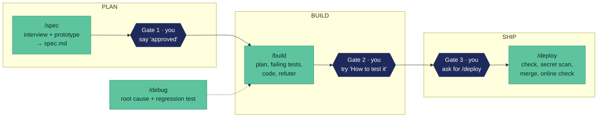

# softwarefactory

A reusable **Agentic Development Lifecycle (ADLC)** for Claude Code: a way to take software from
idea to production faster, with AI agents doing the work and a person making the decisions.

Agents interview you, write the spec and a clickable prototype, build with tests first, try to
break their own work, debug to the root cause and publish. You own the problem, the priorities,
the acceptance criteria and the release. It works the same whether you are an engineer or a
product manager: the agents adapt how technical they are to you.

It's stack-agnostic: no product, no stack, no provider. Each project defines its own
technology, test command and deployment.

## Why it exists
- **Faster from idea to production.** Writing the spec, planning, coding, testing, reviewing
  and documenting are all work agents can do today. What they need is an order to do it in
  and checks that make the result trustworthy. That's what this lifecycle gives them.
- **A lifecycle, not a prompt.** Ad hoc prompting can produce code quickly, but it tends to
  leave gaps in the spec, the tests and the record of why. Here every change follows the same
  path, spec → build with tests → adversarial review → publish, with a person deciding at
  each gate.
- **For engineers and product managers alike.** A product manager can take an idea to a
  tested, published feature without writing code. An engineer gets the spec, the tests and
  the docs that usually get skipped, and spends their time on the decisions and the review
  instead of the typing.

## The loop at a glance
Agents work between the gates. A person decides at each gate.



Green: agents do the work. Dark blue: you decide. `/debug` can be called from anywhere; its
fix goes back through the build with a regression test.

| Gate | Who | What passes it |
|---|---|---|
| 1 · Spec | You | Say "approved" on `spec.md`. Workflow rule: agents don't build from an unapproved spec. |
| 2 · Try it | You | Follow the "How to test it" steps `/build` hands over, one per acceptance criterion. Engineers usually review the branch's diff here too. |
| 3 · Publish | You | Ask for `/deploy`. Workflow rule: agents don't merge into `main` or publish without that request. |

## Quick start
**You need:** Claude Code, a git repository for the project, and the project's own runtime and
test tooling. Publishing also needs a hosting setup you're authorized to deploy to.

1. Copy everything in this repository (including `.claude/`) into the project's root. If the
   project already has some of these files, review them before overwriting.
2. In `CLAUDE.md`, set the **owner language** (Spanish or English) and the **owner profile**
   (technical or non-technical).
3. Open Claude Code there and run `/spec` with the first feature. It fills in the _TODO_
   sections of `AGENTS.md` (project, stack, commands) with you as part of the interview.
4. Put the project's test command in `.claude/test-command` (the first `/build` does it if
   you don't), and add the stack's ignores to `.gitignore`.
5. Before the first `/deploy`, fill in **Publishing** in `AGENTS.md`: host, online check and
   the names of the secret variables.

Everyday commands:

```text
/spec <feature or problem>
/build
/debug <symptom or error>
/deploy
```

## Who does what
| | Does | Never does |
|---|---|---|
| **You** (engineer or product manager) | Bring the problem, choose between the options the agent lays out, approve the spec, try the result (and review the code, if you want to), decide when to publish. | Have to write the spec, the tests or the docs by hand. |
| **Agents** | Write the spec, the prototype, the plan, the tests, the code and the docs. Verify every criterion and try to break their own work before showing it. Log every judgment call. Talk to you in your language and at your level: technical with an engineer, plain words with someone who doesn't program. | Build an unapproved spec, merge into `main` or publish on their own, set priorities, or hide a failure. |

## One contract, end to end
The approved acceptance criteria are numbered (AC-01, AC-02…) and the same list is used at
every step:

1. `/spec` writes them in product language and you approve them.
2. `/build` turns each one into a test that fails first, named after its AC ID, then writes
   the code that makes it pass.
3. The `refuter` sub-agent tries to prove each one is NOT met.
4. You try the same list, by AC ID, in "How to test it".
5. When something breaks later, `/debug` adds a regression test for the reproduced failure.

Agents never reword a criterion on the way. If the requirements change, the spec is updated
and approved again.

An illustrative example of one criterion through the loop:

| Step | AC-01 · The accountant downloads the selected month's orders |
|---|---|
| Spec | A spreadsheet with only the orders of the month you pick. |
| Build | A failing test for the month filter, then the code that makes it pass. |
| Refuter | Tries the first and last day of the month, time zones, and orders from the next month. |
| You | Pick a month, download the file and compare it with the orders you expect. |
| Debug | If a month boundary fails later, reproduce it and add a regression test for that case. |

## `/spec` in practice
A conversation, not a form: one question at a time. With someone who doesn't program it never
uses a technical word. An illustrative example:

> **You:** /spec I want customers to be able to download their orders.
>
> **Agent:** Before anything else, the problem: who needs the download, and what do they do
> with it afterwards?
>
> **You:** Our accountant. She copies everything into a spreadsheet every month.
>
> **Agent:** Then the goal is to save her that copying. Three ways: (a) a spreadsheet file with
> the month's orders, (b) an automatic email on the 1st of every month, (c) a direct
> connection to her accounting software. (a) is the fastest to have; (c) saves her the most
> work but depends on which software she uses. Which one is closest?
>
> **You:** (a).
>
> **Agent:** Two edge cases, then I'll draft the spec: orders that were refunded, do they go
> in the file? And if a month has thousands of orders, is it fine for the download to take a
> few seconds?

A few minutes later: `specs/004-download-orders/spec.md` with the problem, the flow, the
rules, the edge cases and the numbered acceptance criteria, plus a clickable prototype,
waiting for "approved".

## `/debug`: when something breaks
At any point, give it the symptom (an error, a screenshot, "it does X instead of Y").

1. **Reproduce:** make it fail on demand. Not being able to is already a finding.
2. **Isolate:** shrink it to the smallest failing case, ideally a failing test.
3. **Name the cause:** one sentence, with the exact line as evidence, even when the cause is in
   a different part of the system than the symptom.
4. **Fix and guard:** fix the cause, add a regression test, and look for the same bug elsewhere.

It doesn't mask symptoms: no longer timeouts, extra retries or looser checks to make an error
go away, unless the evidence shows that is the actual cause. And it doesn't guess.

## Principles
- **Agents propose, you decide.** Approving a spec, accepting the result and publishing are
  always yours.
- **Nothing is trusted until someone tried to break it.** First the `refuter`, then you.
- **A criterion without a test isn't done.** Each one starts as a failing test. If the
  behavior grew and the tests didn't, that's a warning, not a pass.
- **Small doubts don't stop the build.** Minor ones are decided and logged in `decisions.md`;
  the build only stops for irreversible actions, security-sensitive changes, anything beyond
  its branch, or a broken spec.
- **Every feature has one home.** One folder per feature (`specs/NNN-name/`) holds the spec,
  the prototype, the plan and the decisions; the branch and the commits carry the same name.
- **Code says what the system does; the spec says what it should do.** When docs and code
  disagree, the docs are fixed. When code and an approved spec disagree, someone investigates:
  either the code is fixed or the spec is changed with your approval.
- **The way of working improves like code.** A better rule or command is a change to this
  repository, reviewed and versioned like any other.

## What's inside
| Piece | File | What it does |
|---|---|---|
| Rules for the agent | [`CLAUDE.md`](CLAUDE.md), [`AGENTS.md`](AGENTS.md) | How to talk to you (your language, your technical level), the workflow, the hard rules. `AGENTS.md` is a template with _TODO_ sections for the project. |
| `/spec` | [`.claude/commands/spec.md`](.claude/commands/spec.md) | Interviews you one question at a time, builds a clickable prototype if there are screens, and writes `specs/NNN-name/spec.md` with numbered criteria until you approve it. |
| `/build` | [`.claude/commands/build.md`](.claude/commands/build.md) | Builds an approved spec without pauses: plan in `tasks.md`, test first, one commit per task, minor rulings in `decisions.md`. |
| `/debug` | [`.claude/commands/debug.md`](.claude/commands/debug.md) | From a symptom to the root cause, with a regression test. |
| `/deploy` | [`.claude/commands/deploy.md`](.claude/commands/deploy.md) | Runs the full check, scans the commits for secrets, merges into `main`, pushes and waits until the new version is online. |
| `refuter` | [`.claude/agents/refuter.md`](.claude/agents/refuter.md) | Sub-agent that tries to prove each task does NOT meet its criteria or breaks a hard rule. |
| Tests hook | [`.claude/hooks/stop-tests.sh`](.claude/hooks/stop-tests.sh), `.claude/test-command` | While `/build` runs, Claude Code can't finish with failing tests. |
| Permissions | [`.claude/settings.json`](.claude/settings.json) | Blocks reading env files with secrets, force pushes and `rm -rf`. |
| Documentation skeleton | `ARCHITECTURE.md`, `docs/`, `specs/` | Where each kind of knowledge lives: ADRs, providers, runbooks, status, business, specs. |

## Safety and limits
- **It's a way of working, not a security boundary.** The gates and "never" rules are
  instructions agents follow; the hook and the permissions are the only parts Claude Code
  enforces. Neither replaces access control.
- **For production, add your own guards:** branch protection on `main`, CI that runs the
  tests on every push, and deployment permissions limited to the people who should have them.
- **Tests and review raise confidence; they don't prove correctness.** High-risk changes
  (money, security, personal data) still deserve a human review of the code.

## Conventions
- The agent talks to the owner (whoever directs the work) in the **owner language** and at the
  **owner profile** set in `CLAUDE.md`.
- Everything written to the repository is in English: code, code comments, commits,
  documentation, specs.
- One folder per feature in `specs/`, one file per durable decision in `docs/adr/`.
